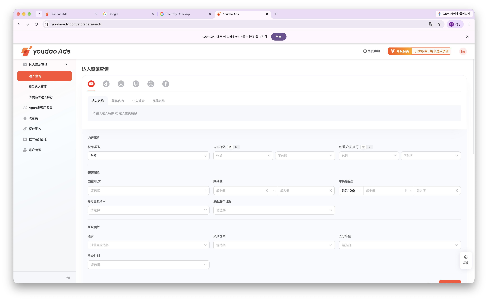
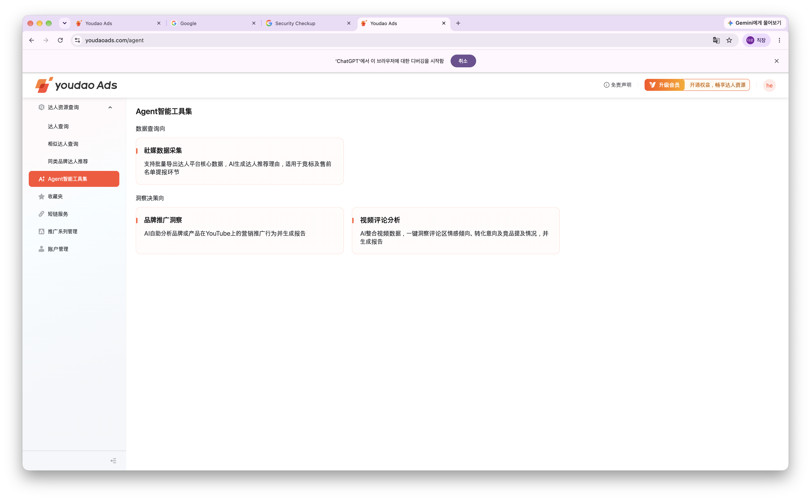
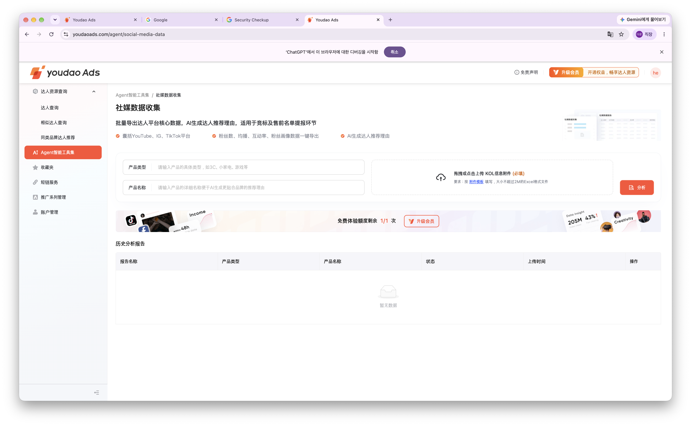
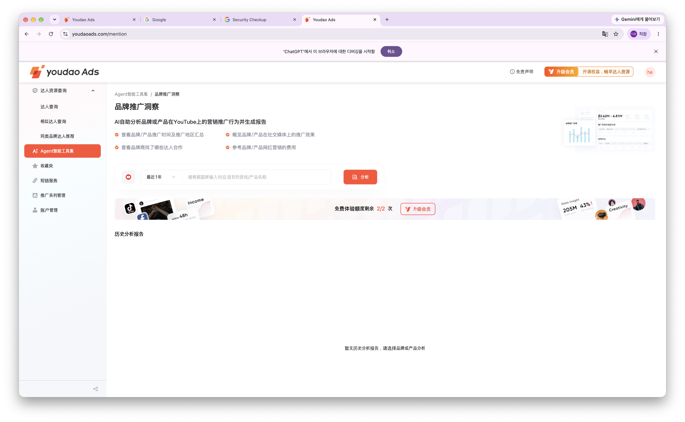
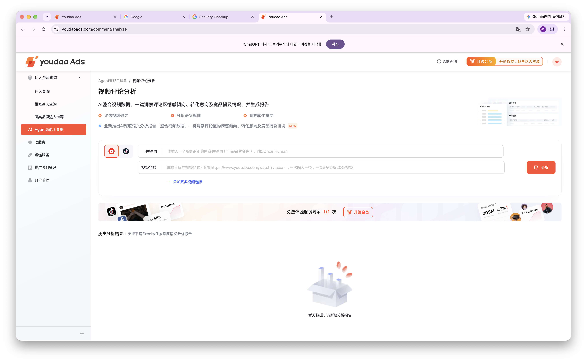

# Youdao Ads 브랜드 화면 분석과 Futures Brand 기능 비교

확인일: 2026-11-05 · 기준 시간대: Asia/Seoul

Youdao Ads의 로그인된 브랜드 화면 8개와 Agent 상세 3개를 살펴보고 Futures의 현행 코드·제품 기획과 비교했다. Youdao에서는 인플루언서 탐색과 분석이 주요 동선이고, Futures는 브랜드의 의뢰를 받아 운영팀이 후보를 선정한 뒤 공식 제안·제작·성과를 관리하는 흐름을 지향한다. 따라서 검색·유사 인물·일반 즐겨찾기의 부재는 보완해야 할 격차가 아니라 의도한 차이다.

Futures에는 요청·공식 제안·제작 검수·성과·청구의 연결 코드가 이미 있다. 실제 보완 대상은 익명 프리뷰, 운영 기한 자동화, 인물별 공급 신청, 문서 통합, 계정 운영, 캠페인에 연결된 분석과 추적이다.

## 바로가기

- [Youdao 상세 분석](#인플루언서-검색)
- [Agent 상세 분석](#agent-도구와-상세-화면)
- [Futures의 비교 기준](#futures의-비교-기준)
- [메뉴별 차이와 도입 판단](#메뉴별-차이와-도입-판단)
- [현재 Brand 구현 상세](#현재-brand-구현-상세)
- [구현해야 할 작업과 완료 기준](#구현해야-할-작업과-완료-기준)
- [코드와 기획 근거](#코드-근거)
- [현재 화면 증거](#현재-화면-증거)

## 범위와 확인 수준

- **현재 화면**: 사용자가 열어둔 Chrome의 로그인된 Youdao Ads 계정에서 메뉴·입력·표·상세·빈 상태를 확인했다. 원문 중국어 라벨은 기능 식별에 필요한 곳만 남기고 의미를 한국어로 정리했다.
- **실행 범위**: 화면 탐색·탭 전환·행 추가·빈 입력 검증·접근 제한 확인을 중심으로 조사했다. 신규 검색·AI 보고서 생성, 유료 결제, 문의 발송, 계정 저장은 결과 검증 범위에 포함하지 않는다. 표나 소개 문구에 있는 기능과 실제 생성 결과를 구분한다.
- **현재 코드**: 로컬 저장소의 `44883d3` 커밋을 기준으로 화면·API·데이터 모델 연결을 확인했다. Futures 운영 DB를 조회하거나 실제 캠페인을 실행한 결과는 아니다.
- **과거 관찰**: 2026-11-01 기록은 현재 관찰을 보완하는 곳에서 날짜를 명시한다. 그때의 제한과 현재 상태를 섞어 서비스 전체 기능으로 일반화하지 않는다.
- 계정의 이름·이메일·전화·회사명은 문서와 보관하는 관찰 텍스트에서 제외했다. 계정 화면은 개인정보 때문에 이미지 대신 필드와 상태 기록을 남겼다.

## Youdao의 공통 화면 구조

상단에는 로고, 면책 안내, 회원 업그레이드, 계정 진입점이 있고 왼쪽 탐색 영역에는 인플루언서 리소스 검색의 하위 메뉴 3개, Agent, 즐겨찾기, 단축 링크, 캠페인 관리, 계정 관리가 배치된다. 선택 메뉴를 주황색으로 강조하고 본문은 흰색 카드·연한 배경의 필터·가로 데이터 표로 구성한다.

| 구분 | 중국어 메뉴 | 사용자 목적 |
| --- | --- | --- |
| 인플루언서 검색 | 达人查询 | 조건으로 후보를 직접 찾기 |
| 유사 인플루언서 검색 | 相似达人查询 | 기준 채널과 비슷한 후보 찾기 |
| 동종 브랜드 추천 | 同类品牌达人推荐 | 관련 브랜드·제품을 통해 후보 넓히기 |
| Agent | Agent智能工具集 | 데이터 수집과 분석 보고서 요청 |
| 즐겨찾기 | 收藏夹 | 찾은 후보를 폴더로 모으기 |
| 단축 링크 | 短链服务 | 링크와 방문 지표 관리 |
| 캠페인 관리 | 推广系列管理 | 현재 계정에서는 대행 서비스 소개와 문의 |
| 계정 관리 | 账户管理 | 개인·회사·보안 설정 |

탐색·분석 화면에는 무료 체험 잔여 횟수와 업그레이드가 반복해서 표시된다. 아래 횟수는 이 계정의 확인 시점 표기이며 모든 계정에 적용되는 요금제 조건이 아니다. 결과가 없는 분석 화면은 입력폼 아래에 이력 또는 빈 상태를 둔다.

## 인플루언서 검색

원본: [인플루언서 검색](https://www.youdaoads.com/storage/search) · 현재 관찰 Y01

이름이나 콘텐츠 조건을 입력해 인플루언서 목록을 직접 탐색하는 화면이다. 초기 화면부터 인물명·국가·채널 지표와 최근 영상이 보이므로 Futures의 제안 전 비공개 정책과는 공개 범위가 다르다.

| 영역 | 확인한 항목 |
| --- | --- |
| 플랫폼 | YouTube, TikTok, Instagram, Twitch, Twitter, Facebook |
| 검색 기준 | 인플루언서 이름, 미디어 콘텐츠, 개인 소개, 브랜드 이름 |
| 콘텐츠 속성 | 영상 유형, 콘텐츠 태그, 채널 키워드 |
| 조건 조합 | 태그·키워드 포함/제외, OR/AND |
| 채널 속성 | 국가·지역, 팔로워 범위, 평균 노출 범위, 노출 변동률, 최근 게시일 |
| 시청자 속성 | 언어, 국가, 연령, 성별 |
| 행동 | 초기화, 검색, 결과 정렬, 행 선택 |
| 결과 열 | 기본 정보, 팔로워, 평균 노출, 태그, 참여율, 조회수/팔로워 비율, 최근 영상, 작업 |
| 현재 상태 | 로딩 완료 후 실명·지표가 있는 10행 노출, 페이지 크기와 페이지 탐색, 무료 체험 표기 3/3 |

필터는 콘텐츠·채널·시청자라는 서로 다른 의미로 묶인다. 평균 노출 필터에는 최근 10개 영상 기준이 있고 결과 행에는 최근 10개·최근 30일 등 기간별 수치가 보인다. 숫자만 보여주는 방식보다 집계 기간을 함께 표시한다는 점을 참고할 수 있다.

재방문 직후 잠깐 보인 빈 표는 로딩 완료 후 실제 결과로 바뀌었다. 이번에는 새 검색을 실행해 추천 품질이나 필터 정확도를 평가하지 않았다. 기본 노출 목록과 검색·정렬 컨트롤의 존재를 확인한 범위다. 콘텐츠 키워드·해시태그 최대 15개 같은 세부 제한은 기존 11월 1일 실사에도 기록되어 있으며 현재 모든 플랫폼의 입력 조합을 반복 실행한 결과로 간주하지 않는다.

**Futures 적용:** 콘텐츠·채널·시청자 필터의 그룹화는 Admin 내부 인물 DB에 참고할 수 있다. Brand에는 목표·매체·타깃·예산을 전달하는 브리프와 운영팀의 공식 제안을 제공한다.

## 유사 인플루언서 검색

원본: [유사 인플루언서 검색](https://www.youdaoads.com/storage/similar-search) · 현재 관찰 Y02

기준 채널의 주소를 넣고 유사한 인물을 찾는 화면이다. 검색과 같은 결과 표를 사용하되 입력의 중심이 키워드에서 기준 채널로 바뀐다.

| 영역 | 확인한 항목 |
| --- | --- |
| 플랫폼 | YouTube, TikTok |
| 기준 입력 | 채널 홈페이지 링크 |
| 보조 필터 | 국가·지역, 팔로워 범위, 평균 노출과 기준 기간, 언어 |
| 행동 | 초기화, 검색, 관련성 정렬, 행 선택 |
| 결과 표 | 기본 정보·팔로워·평균 노출·태그·참여율·조회/팔로워 비율·최근 영상 |
| 빈 상태 | 표준 홈페이지 링크를 입력하라는 안내 |
| 현재 상태 | 입력 전 결과 없음, 무료 체험 표기 3/3 |

채널 URL의 입력 목적과 빈 상태의 다음 행동이 연결된다. 실제 유사도 점수·추천 기준·실행 시간·결과의 정확도는 검색을 실행하지 않아 확인 범위 밖이다.

**Futures 적용:** 브랜드의 ‘이 사람 대신 다른 후보를 제안해 달라’는 요청은 공식 제안의 대안 요청으로 받는다. 해당 유사 검색 도구가 필요하면 운영팀 내부 소싱에 둔다.

## 동종 브랜드 인플루언서 추천

원본: [동종 브랜드 추천](https://www.youdaoads.com/storage/similar-brands) · 현재 관찰 Y03

경쟁 브랜드·게임·제품의 정보를 기준으로 관련 브랜드와 인플루언서 후보를 넓히는 목적이다. 화면 상단의 기능 설명과 ‘예시 보기’, 브랜드·제품 입력, 선택 필터, 분석 실행, 과거 목록으로 구성된다.

| 영역 | 확인한 항목 |
| --- | --- |
| 기준 입력 | 국가의 언어에 맞는 게임·제품 이름을 입력하는 선택형 필드 |
| 필터 | 국가·지역, 팔로워, 평균 노출, 언어, 출시 플랫폼 |
| 출시 플랫폼 | 현재 기본값은 모바일 게임 |
| 행동 | 필터, 분석, 예시 보기 |
| 이력 | 과거 목록, 새 분석 보고서를 만들라는 빈 상태 |
| 현재 상태 | 무료 체험 표기 1/1 |

‘예시 보기’로 들어가는 `/storage/similar-brands/example`에는 원 브랜드·관련 브랜드, 영상 유형·협업 성격·최근 게시일·콘텐츠 태그, 관련성 정렬과 인물 표가 있다. 로딩 완료 후 기본 정보·팔로워·평균 노출·태그·참여율·관련 브랜드·최근 영상이 포함된 예시 10행을 확인했다. 일부 관련 브랜드명은 흐림 처리되고 필터는 비활성화되어 있다. 접근성 텍스트에서 이름이 읽히더라도 화면에 공개된 정보와 동일하게 취급하지 않는다.

이 메뉴의 중심은 브랜드 분석 자체보다 관련 인물 목록의 확장이다. 기본 제공 예시와 사용자의 조건으로 새로 생성한 결과는 구분해야 한다. 실제 생성 결과의 데이터 최신성·비용 산정·추천 로직은 확인하지 않았다.

**Futures 적용:** 시장·장르·경쟁 제품에 대한 분석 질문은 캠페인 요청으로 받을 수 있다. 브랜드에 전체 협업 인물 목록이나 후보 검색으로 이어지는 진입점을 제공하지 않는다.

## Agent 도구와 상세 화면

원본: [Agent 도구](https://www.youdaoads.com/agent) · 현재 관찰 Y04

도구 홈은 ‘데이터 조회’와 ‘인사이트·의사결정’ 두 영역으로 나뉜다. 첫 영역에 소셜 데이터 수집 카드 1개, 두 번째에 브랜드 홍보 분석과 영상 댓글 분석 카드 2개를 배치한다. 각 카드는 제목·용도 설명을 제공하고 전용 입력 화면으로 이동한다.

### 소셜 데이터 수집

원본: [소셜 데이터 수집](https://www.youdaoads.com/agent/social-media-data) · 현재 관찰 Y04A

여러 인플루언서의 핵심 지표를 모으고 추천 이유를 생성해 입찰·사전 제안 명단을 준비한다는 설명이다. 이 설명은 제품의 제공 목적이며 실제 생성 보고서의 품질을 검증한 결과는 아니다.

| 영역 | 확인한 항목 |
| --- | --- |
| 대상 안내 | YouTube·Instagram·TikTok, 팔로워·평균 재생·참여율·시청자 정보, AI 추천 이유 |
| 입력 | 제품 유형, 제품명 |
| 파일 | KOL 정보 Excel 첨부 필수, 2MB 이하, 드래그/클릭 업로드, 첨부 템플릿 링크 |
| 실행 | 분석 버튼 |
| 이력 열 | 보고서명, 제품 유형, 제품명, 상태, 업로드 시각, 작업 |
| 현재 상태 | 이력 없음, 무료 체험 표기 1/1 |

11월 1일 템플릿 관찰에는 닉네임과 채널 URL이 필수라고 기록되어 있다. 이번에는 개인 인물 명단을 업로드하거나 보고서를 생성하지 않았다. 파일 형식 안내와 보고 이력의 구조를 확인했다.

**Futures 적용:** 인물 명단을 다루는 기능은 Admin의 후보 조사·제안 준비에 가깝다. Brand에 일괄 인물 DB 수집 기능으로 노출할 이유는 없다. 파일 양식·처리 상태·오류·결과 버전 패턴은 내부 업무에 참고한다.

### 브랜드 홍보 분석

원본: [브랜드 홍보 분석](https://www.youdaoads.com/mention) · 현재 관찰 Y04B

브랜드나 제품의 YouTube 마케팅을 분석하는 입력 화면이다. 소개에는 홍보 기간·지역, 홍보 효과, 협업한 인플루언서, 비용 참고 정보가 나온다. 결과 보고서는 현재 이력이 없어 직접 검증하지 않았다.

| 영역 | 확인한 항목 |
| --- | --- |
| 입력 | 게임·제품·브랜드 선택형 필드 |
| 기간 | 드롭다운에서 최근 1년·반년·90일·30일을 확인. 기본 최근 1년 |
| 행동 | 분석 |
| 이력 | 과거 분석 보고서, 브랜드·제품을 선택하라는 빈 상태 |
| 현재 상태 | 무료 체험 표기 2/2 |

**Futures 적용:** 브랜드가 원하는 질문·대상 제품·시장·기간을 먼저 받는 구조는 유용하다. 결과에서 후보나 협업자 정보가 드러난다면 기존 공개 정책에 맞춰 운영팀이 검토한 범위만 전달한다. 현재 범용 자유문 요청을 목적별 폼으로 보완할 수 있다.

### 영상 댓글 분석

원본: [영상 댓글 분석](https://www.youdaoads.com/comment/analyze) · 현재 관찰 Y04C

영상의 반응·감성·전환 의도·경쟁 제품 언급을 분석한다는 도구다. YouTube와 TikTok 선택, 제품·브랜드를 식별할 키워드, 영상 링크를 입력하고 여러 영상 행을 추가한다. 플레이스홀더는 한 번에 최대 20개 영상을 안내한다.

| 영역 | 확인한 항목 |
| --- | --- |
| 플랫폼 | YouTube, TikTok |
| 입력 | 키워드, 영상 URL |
| 반복 입력 | ‘영상 링크 더 추가’로 새 행 추가 |
| 검증 | 빈 상태에서 분석을 누르면 키워드와 영상 링크의 필수 안내 표시 |
| 결과 안내 | 과거 분석 결과에서 Excel 다운로드 또는 심층 의미 분석 보고서 생성 지원이라고 설명 |
| 현재 상태 | 이력 없음, 입력 검증 후에도 무료 체험 표기 1/1 |

필수 오류가 입력 옆에 나타나는 것과 실제 AI 실행은 구분된다. Excel 내보내기·감성 분류·전환 의도 결과는 소개와 빈 이력 화면에 있는 설명을 확인했으며 실제 결과 파일을 생성해 평가하지 않았다.

**Futures 적용:** 승인된 캠페인 게시물을 선택하거나 외부 URL을 추가해 분석을 요청하게 만들 수 있다. 자동 감성 분석보다 먼저 운영팀이 결과를 검토·공개하고 측정 시점과 대상 영상을 추적할 수 있어야 한다.

## 즐겨찾기

원본: [즐겨찾기](https://www.youdaoads.com/storage/collect) · 현재 관찰 Y05

인플루언서 후보를 폴더로 모으는 공간이다. 현재 화면에서 폴더 검색과 검색 버튼, 새 폴더 버튼을 확인했다. 신규 진입 시 회원 업그레이드 팝업이 나타났다. 기존 기본 폴더를 열면 `/storage/collect?favoriteId=0`의 상세로 이동한다. 현재 0명이며 기본 정렬·검색·행 선택, 기본 정보·팔로워·평균 노출·태그·참여율·조회/팔로워 비율·최근 영상·평가·작업 열을 확인했다.

폴더 생성과 후보 저장, 평가의 실제 저장 결과는 확인 범위에 포함하지 않는다. 브랜드가 후보를 계속 수집하는 기능은 Youdao의 직접 탐색 흐름과 연결된다.

**Futures 적용:** 일반 인물 즐겨찾기는 Brand에 제공하지 않는다. 브랜드가 기억해야 할 정보는 캠페인에 발행된 공식 제안·승인 이력이고, 후보를 묶어 검토하는 기능은 Admin에 둔다.

## 단축 링크

원본: [단축 링크](https://www.youdaoads.com/shortLinks) · 현재 관찰 Y06

독립된 링크 관리 화면이다. 상단 검색 조건, 목록 정렬과 새 링크 버튼, 지표를 포함한 데이터 표로 구성된다.

| 영역 | 확인한 항목 |
| --- | --- |
| 필터 | 단축 URL, 이름, 생성일 범위 |
| 행동 | 초기화, 검색, 기본 역순 정렬, 새 단축 링크 |
| 목록 열 | 이름, 단축 URL, 총 PV, 총 UV, 데이터 효과 추적, 원본 URL, 생성 시각, 작업 |
| 현재 상태 | 목록 비어 있음. 새 단축 링크 진입 시 회원 업그레이드 팝업 |

PV·UV·효과 추적 열의 존재는 확인했지만 방문 식별 방식, 봇 제외, 기간별 집계, 전환 추적의 정확성까지 확인한 것은 아니다. 현재 계정에서는 신규 진입이 회원 업그레이드로 이어져 실제 생성 폼·발행·상세 통계는 확인하지 못했다.

**Futures 적용:** 기존 링크 생성 기능을 캠페인·제작물의 성과 안으로 연결한다. 현재 Futures의 카운트는 ‘GET 이동 요청 수’이므로 Youdao의 PV·UV 열 이름만 복제해 붙이면 지표 의미가 잘못 전달된다.

## 캠페인 관리

원본: [캠페인 관리](https://www.youdaoads.com/advertiser/campaign) · 현재 관찰 Y07

현재 계정에서 이 주소는 캠페인 목록이 아니라 Youdao의 인플루언서 마케팅 대행 서비스 소개를 보여준다. 인플루언서 매칭, 인물 정보·견적 확인, 프로젝트·협업 상태 추적, 데이터 모니터링, 회고 보고서 생성을 소개하고 ‘문의하기’ 버튼을 제공한다.

| 구분 | 현재 확인 결과 |
| --- | --- |
| 실제 보이는 화면 | 대행 서비스 소개와 문의 버튼 |
| 소개가 약속하는 업무 | 후보 매칭, 견적 확인, 진행 추적, 효과 평가, 회고 보고서 |
| 현재 계정에서 확인되지 않은 업무 화면 | 캠페인 생성·목록·상세, 제안 승인, 콘텐츠 검수, 계약·정산 |

문의 버튼을 눌렀을 때 현재 화면의 텍스트에서 새로운 폼이나 운영 목록은 확인되지 않았고 문의는 발송하지 않았다. 이 소개 문구를 실제 캠페인 대시보드의 상세 UI로 해석하지 않는다. 반대로 현재 계정에 노출되지 않았다는 이유로 서비스 전체에 운영 기능이 없다고 결론 내리지 않는다.

**Futures 적용:** 현재 Futures의 실제 캠페인 운영 화면은 자체 기획과 코드로 평가해야 한다. Youdao 소개에 있는 작업의 이름을 참고할 수는 있지만 승인 상태·버전·권한·정산 구조를 그 화면에서 검증했다고 설명할 수 없다.

## 계정 관리

원본: [계정 관리](https://www.youdaoads.com/advertiser/accountManagement) · 현재 관찰 Y08

개인 정보·회사 정보·보안 설정의 3탭이다. 실제 탭 선택 상태가 바뀌고 각 영역의 필드가 달라지는 것을 확인했다. 개인값은 복제하지 않고 필드 구조만 기록했다.

| 탭 | 필드와 행동 |
| --- | --- |
| 개인 정보 | 필수 이름·직위·이메일, 전화 국가코드·번호, 편집 |
| 회사 정보 | 필수 회사명·업종·국가·회사규모, 웹사이트, 홍보 제품, 편집 |
| 보안 설정 | 이메일, 마스킹된 비밀번호, 비밀번호 재설정 진입점, 제휴 정보·알림 수신 동의 |

11월 1일에는 편집 시 저장·취소와 제품 행 추가 후 취소를 확인했다. 실제 계정 저장과 비밀번호 재설정 메일 발송은 수행하지 않았으며 재설정 절차 전체가 검증된 것으로 표시하지 않는다.

**Futures 적용:** 개인·회사·보안의 구분과 조회/편집/취소는 참고할 만하다. Futures에는 승인 상태·보완 요청·구매자 유형·최종 광고주 구분을 추가해야 하고, 담당자명 변경과 로그인 계정 변경을 구분해 안내해야 한다.

## 지표를 비교할 때 구분할 의미

| 표시 | 비교 시 주의할 점 |
| --- | --- |
| Youdao의 평균 노출과 참여율 | 화면의 집계 기간은 확인했지만 계산식·원본 수집 정확도는 미검증. Futures의 평균 조회수와 같은 값이라고 전제하지 않음 |
| Youdao의 PV·UV | 표의 구분만 확인. Futures의 GET 리다이렉트 요청 수와 다른 지표 |
| 댓글의 전환 의도 | 댓글에서 추정하는 의향과 실제 구매·설치 전환은 구분 |
| 브랜드 홍보의 비용 참고 | 분석 서비스가 설명하는 참고 정보와 Futures의 확정 판매가·공급 원가는 구분 |
| 프리뷰 예상 가격과 공식 제안가 | 가정에 따른 범위와 운영팀이 확인해 발행한 가격을 구분 |

## 화면에서 가져올 패턴과 적용하지 않을 패턴

| 패턴 | 판단과 적용 위치 |
| --- | --- |
| 목적별 입력폼과 가까운 필수 오류 | 캠페인 요청·분석 요청에 적용 |
| 필터를 의미별로 구분 | Admin의 내부 후보 DB, Brand의 캠페인·문서 목록에 적용 |
| 입력 위의 짧은 용도 설명 | 요청자가 결과를 예상할 수 있게 적용하되 확인하지 않은 자동화 효과를 약속하지 않음 |
| 결과 이력과 상태·생성일 | 제안·검수·분석·문서의 버전 및 처리 이력에 적용 |
| 데이터 표의 수치와 기간 | 공식 제안 지표·게시 성과에 적용. 미집계와 0, 출처·기간을 구분 |
| 빈 상태의 다음 행동 | ‘데이터 없음’과 함께 새 요청·자료 보완·운영 문의 등 가능한 행동 제시 |
| 실명 디렉터리와 일반 후보 저장 | Brand에는 미적용. 필요한 소싱 범위만 Admin에 검토 |
| 무료 횟수와 회원 업그레이드 | Futures 승인제 운영의 필수 기능으로 채택하지 않음 |
| 독립 AI 메뉴와 범용 링크 메뉴 | 캠페인의 분석 요청·게시물 성과로 통합 |

## Futures의 비교 기준

Futures의 구매자는 광고주와 광고주를 대신하는 구매자 대행사다. 공급 Agency는 인플루언서를 보유하거나 섭외하는 MCN·에이전시이며, Futures Admin이 구매자와 공급자 사이에서 선정과 거래를 운영한다. 화면에 같은 ‘에이전시’라는 단어가 등장하더라도 구매자와 공급자의 권한은 분리한다.

기본 흐름은 **브랜드 의뢰 → Futures 후보 검토와 섭외 → 공식 제안 → 브랜드 승인 → 제작과 검수 → 게시와 성과 → 청구**다. 이름·사진·채널은 Futures가 공식 제안을 발송할 때 그 캠페인에 제안한 인물에 한해 공개한다. 브랜드가 승인하기 전 제안을 검토할 수 있어야 하므로 공개 시점을 최종 계약 완료 이후로 잡지 않는다.

크리에이터 연락처·공급 파트너 이름과 연락처·공급 원가·마진·내부 메모·파트너 원신청은 공식 제안 이후에도 브랜드에 제공하지 않는다. 화면에서 감추는 것뿐 아니라 서버의 응답과 첨부 접근에도 이 원칙이 적용된다. 최종 제품 기획 3·4·7·9·11쪽과 기존 브랜드 화면 기획이 이 기준을 명시한다. [기획 근거](#기획-근거)

다음 표는 **기획상 목표 공개 범위**다. 실제 익명 프리뷰 등 미완성 기능은 뒤의 구현 현황에서 별도로 구분한다.

| 단계 | Brand가 확인하는 것 | Futures와 Agency의 내부 업무 |
| --- | --- | --- |
| 요청과 프리뷰 | 목표·예산·일정, 익명 구성·가격 범위 | 조건 정리, 내부 후보와 가격·가용성 검토 |
| 후보 검토와 모집 | 진행 상태·예정 시각 | 후보 목록, 공급자 신청, 공급가, 연락처 |
| 공식 제안 | 제안된 인물·채널·판매가·일정·제작 조건·사용권 | 공급자 계약 조건, 내부 선정 이유와 원가 |
| 승인 후 실행 | 공개된 제작물과 검수 이력, 게시 링크와 성과 | 공급자 원문 제출, 운영 검수, 미공개 수정본 |
| 완료와 청구 | 자기 캠페인 청구·입금 확인 상태 | 공급자 지급과 플랫폼 마진 |

## 메뉴별 차이와 도입 판단

‘의도적 제외’는 기획에 맞게 제공하지 않는 기능이다. ‘연결 구현’은 로컬 소스의 화면·서버·DB 처리 경로를 확인했다는 뜻이며 운영 배포의 성공 여부와 구분한다. ‘부분 구현’은 기반은 있으나 아래의 목표 흐름이 완결되지 않은 경우다.

| Youdao 메뉴 | Futures 현재 상태 | 차이의 성격 | Futures에서 할 일 |
| --- | --- | --- | --- |
| 인플루언서 검색 | 브랜드 접근은 캠페인으로 이동, 관련 API 404 | 의도적 제외 | 브랜드에는 조건 입력을 제공. 필터·표 패턴이 필요하면 Admin 내부 소싱에 적용 |
| 유사 인플루언서 검색 | 같은 정책으로 차단 | 의도적 제외 | 브랜드는 공식 제안에서 대안 요청, Futures가 대체 후보 선정 |
| 동종 브랜드 추천 | 인물 추천 디렉터리 차단 | 의도적 제외 | 시장·경쟁 분석 요청은 가능하되 인물 후보 명단은 내부에 보관 |
| Agent와 상세 분석 | 독립 경로는 남아 있고 요청 DB 저장만 가능 | 부분 구현 | 캠페인별 분석 요청·운영 검토·결과 공개로 통합. 실제 자동 분석과 수동 요청을 명확히 표시 |
| 즐겨찾기 | 브랜드 일반 인물 컬렉션 차단 | 의도적 제외 | 브랜드에는 공식 제안 버전·승인 이력 제공. 내부 후보 묶음은 Admin 기능 |
| 단축 링크 | 실제 링크 생성·중지·리다이렉트·요청수 집계 | 부분 구현 | 캠페인·제작물 연결, 기간별 집계, 지표 의미와 출처 표시 |
| 캠페인 관리 | 요청·제안·검수·성과·청구 연결 구현 | 핵심 기반 구현, 일부 보완 | 익명 프리뷰, 운영 기한 관리, 문서 통합과 실운영 검수 보완 |
| 계정 관리 | 담당자·회사·보안 탭과 일부 정보 편집 | 부분 구현 | 이메일 인증·복구, 조직 심사·구매자 유형 안내, 구매자 대행사의 고객 구분 보완 |

Futures의 기존 검색 컴포넌트와 데이터 모델이 저장소에 남아 있다는 사실은 현재 브랜드가 그 기능을 사용할 수 있다는 뜻이 아니다. 공통 페이지에서 접근을 돌리고 서버에서도 검색·디렉터리·컬렉션을 차단한다. 기본 사이드바는 홈·캠페인 관리·요청함·청구 내역·자료실이며, Agent와 단축 링크는 직접 URL로 접근할 수 있는 기존 기능으로 남아 있다. [C01](#코드-근거)[C02](#코드-근거)[C03](#코드-근거)

Youdao의 회원 업그레이드와 무료 체험 횟수는 해당 서비스의 판매 정책이다. Futures의 승인제 운영에서 그대로 재현해야 할 기능 격차로 계산하지 않는다. Youdao의 현재 계정에서 캠페인 소개 화면만 보인다는 이유로 그 서비스 전체에 캠페인 운영 기능이 없다고 판단해서도 안 된다.

## 현재 Brand 구현 상세

### 홈과 캠페인 목록

실제 조직의 캠페인·요청을 조회하고 상태별 집계, 승인할 제안, 검수할 제작물, 공개 청구와 예정 일정을 표시한다. 목록은 검색·상태 필터·상세 진입을 지원한다. 최근 100건 제한과 추가 데이터 존재 안내가 있으므로 장기 운영을 위한 전체 이력 페이지네이션은 남은 작업이다. [C03](#코드-근거)[C04](#코드-근거)

### 새 요청과 익명 프리뷰

요청은 브리프 작성, 구성 방향 선택, 최종 확인의 3단계다. 목표·예산·통화·매체·지역·형식·인원·일정 등을 입력하고 초안 저장·재개·접수를 할 수 있다. 중복 제출 식별자와 변경 충돌 검사가 있으며, 맞춤 제안과 오픈 캠페인을 구분해 저장한다. 최초 폼에서 자료를 업로드하는 대신 접수 후 캠페인 요청함에서 첨부하도록 안내한다. [C05](#코드-근거)[C06](#코드-근거)

현재의 균형·도달·효율 3개 카드는 **선호하는 구성 방향**이다. 내부 DB를 바탕으로 인원·티어·가격·도달 범위를 계산한 추천 3안이 아니다. 서버의 기능 상태도 `anonymousPreview: false`로 되어 있다. 이 차이는 버튼 문구만으로 해결되지 않으며 가격·가용성 데이터와 추천 규칙, 익명 응답 설계가 필요하다. [C04](#코드-근거)[C05](#코드-근거)

기획상 완성된 프리뷰에는 안별 인원과 티어, 매체·형식·수량, 가격·도달 범위, 가정과 갱신 기준이 필요하다. 이름·사진·채널·내부 인물 ID와 개인을 쉽게 특정하는 설명은 브랜드 응답에 넣지 않는다. 예상안을 확정 견적으로 표시하지 않고, 인물·가격·일정은 운영팀이 확인한 공식 제안에서 확정한다.

### 기한 운영과 오픈 모집

맞춤 요청을 접수하면 48시간 뒤의 예정 시각을 저장하고 화면에 표시한다. 현재 보완 재접수 처리에서는 기한을 다시 48시간 뒤로 갱신하므로 최초 접수 기준 약속과 보완 중 기한 계산 정책을 맞춰야 한다. 운영팀의 수동 담당 배정·기한 변경, 초과·미배정 집계도 있다. 자동 담당 배정, 12시간 경고, 24시간 에스컬레이션과 예약 알림은 아직 확인되지 않는다. 기한 값이 존재하는 것과 SLA 운영 자동화가 완성된 것을 구분한다. [C06](#코드-근거)[C15](#코드-근거)

오픈 캠페인의 공개 모집과 신청은 실제로 연결되어 있다. 다만 현재 신청 폼은 제안 본문과 총 제안 금액을 받으며, 인물별 형식·수량·공급 단가·가능일을 구조화한 행 입력은 없다. 인물 연결 모델이 있어도 현행 신청 처리에서 채우지 않는다. 초청 기능의 상태는 `invitations: false`다. [C16](#코드-근거)

Agency 신청 화면에 남은 “브랜드와 운영팀에 전달” 안내는 공식 제안만 공개한다는 현재 정책에 맞게 고칠 필요가 있다. 브랜드 원신청 API는 차단되어 있으므로 이 문구만으로 실제 정보 유출이 발생했다고 판단하지 않는다. [C01](#코드-근거)[C16](#코드-근거)

### 공식 제안과 승인

공급자 신청과 별도의 공식 제안 모델이 있다. Admin의 비공개 초안 작성·공개·새 버전 발행과 Brand의 항목별 승인·수정 요청·반려가 연결되어 있다. 자기 조직 캠페인의 발행본만 읽을 수 있으며, 만료·대체된 버전과 이미 처리한 항목의 재결정을 막는다. 결정 이력과 재시도·동시성 처리도 존재한다. [C07](#코드-근거)

브랜드 응답은 제안된 인물의 이름·채널·관련 지표·제작 내용·가격·일정·권리를 담고 공급사·공급가·내부 메모는 제외한다. 모든 항목의 승인에 따라 캠페인 진행 상태와 제작 항목이 연결되지만, 승인 클릭이 계약 서명이나 송금을 실행하는 것은 아니다.

### 제작과 검수

승인된 제안항목에 제작 자료가 연결된다. Agency의 원본 제출과 Futures가 브랜드에 공개하는 제목·링크·설명은 분리되어 있다. 브랜드는 공개된 버전을 검토하고 승인하거나 수정을 요청하며, 새 제출본은 다시 운영 검수를 거친다. 현재 범위는 URL·메모·버전·승인 흐름이며 영상 편집기나 타임코드 기반 코멘트 기능으로 설명하지 않는다. [C08](#코드-근거)

### 게시와 성과

Agency의 게시 링크·측정 시점·지표·증빙 제출, Admin의 검토·공개, Brand의 공개 버전 조회가 연결되어 있다. 미집계와 실제 0을 구분하고 최신 공개본을 기준으로 합산한다. 비공개 수정본이 들어와도 검수 전에는 기존 공개본을 유지한다. [C09](#코드-근거)

현재는 수동 제출과 운영 검증을 바탕으로 하는 성과 관리다. 소셜 플랫폼 API 자동 수집이나 AI 분석 자동 실행과 구분해야 한다. Youdao 화면에 있는 분석 설명이나 PV·UV 열을 보고 동일한 데이터 수집 기능이 이미 구현됐다고 판단할 수 없다.

### 청구와 문서

브랜드는 자기 조직의 발행된 청구와 입금 확인 상태를 볼 수 있다. 항목·수량·단가·합계·기한을 표시하고 외부 발행 문서 URL이 있으면 열 수 있다. 공급자 지급과 브랜드 청구는 분리된다. 입금·지급은 외부에서 처리한 결과를 운영팀이 기록하는 방식이다. [C10](#코드-근거)

일반 자료실과 캠페인의 문서 탭은 아직 독립된 문서 발행·검색·다운로드 기능이 아니다. 서버는 `campaignDocuments: false`, `documents: []`를 반환하고 요청함 첨부로 안내한다. 청구 데이터와 외부 문서 URL이 존재하는 것과 견적서·계약서·보고서를 통합 관리하는 문서함의 완성은 구분한다. [C04](#코드-근거)

### 요청함과 분석 요청

요청함은 실제 DB에 연결되어 캠페인·상태·담당자·기한·회신·이력·첨부를 관리한다. 내부 메모는 브랜드 조회에서 제외되고 첨부도 소유권을 검사한다. PDF·PNG·JPEG를 파일당 4MB, 답변당 최대 5개 첨부하는 경로가 있다. XLSX·CSV·DOCX 첨부는 제공하지 않으며 실제 운영 저장소의 가용성은 별도 확인 대상이다. [C11](#코드-근거)

요청함에서는 분석 유형과 캠페인을 선택하고 운영팀의 회신·결과 첨부를 받을 수 있다. 반면 `/agent`는 캠페인 연결 없이 3종 분석 유형과 제목·본문을 접수하는 기존 화면이다. 도구별로 제품·기간·영상 목록을 구조화하거나 실제 분석 보고서를 생성하는 기능은 없다. 요청함의 캠페인 연결·회신·첨부 기반을 재사용해 분석 목적별 폼과 운영 검토 후 결과 공개를 연결하는 편이 현재 사업 흐름에 맞다. [C12](#코드-근거)

### 단축 링크와 계정

단축 링크는 이름·대상 URL을 저장하고 활성·중지, 필터·정렬·복사를 지원한다. 활성 링크의 GET 요청을 카운트한 뒤 302로 이동하며 HEAD는 집계에서 제외한다. `clickCount`는 총 요청수로, 순 방문자나 전환 수가 아니다. 링크 모델에 캠페인·제작물 연결과 개별 방문 이벤트가 없어 UV·기간별 추적·전환 기여도를 제공하지 않는다. [C13](#코드-근거)

계정은 담당자·회사·보안 탭을 제공한다. 조직 소유자가 수정할 수 있는 값은 회사명·담당자명·웹사이트이며, 담당자명 수정은 조직 메타데이터 변경으로 로그인 사용자명·이메일 변경과 구분된다. 승인된 BRAND 조직과 완료된 프로필을 확인하고, 회사 정보 변경은 조직 소유자로 제한한다. 이메일·승인 상태는 읽기 전용이며 이메일 인증·이메일 비밀번호 복구는 연결되어 있지 않다. 구매자 대행사의 조직 유형을 저장한다고 해서 고객별 캠페인 관리·팀 초대·권한 관리까지 완성된 것은 아니다. [C14](#코드-근거)

## 구현해야 할 작업과 완료 기준

다음 순서는 Youdao의 메뉴 수를 맞추기 위한 목록이 아니라 Futures의 브랜드 업무를 완결하기 위한 제안이다. 기존 제품 기획의 운영 기반 → 맞춤 제안 → 오픈 모집 순서를 유지하되 연결 구현된 기능을 다시 만드는 항목은 제외했다.

| 순서 | 작업 | 현재와의 차이 | 완료 기준 |
| --- | --- | --- | --- |
| 운영 기반과 병행 | 계정 인증과 복구 | 기본 로그인은 구현, 이메일 인증·복구 미연결 | 일반 고객에게 열기 전에 이메일 인증·비밀번호 복구·심사 보완 안내를 운영 가능하게 연결 |
| 1 | 운영 문구와 경로 정리 | 독립 Agent·단축 링크 경로와 일부 공급자 안내에 이전 개념이 남음 | Brand 메뉴와 직접 URL의 역할 일치. 공급자의 원신청은 Futures 검토 자료이고 공식 제안만 브랜드에 전달된다고 안내 |
| 2 | 맞춤 제안 기한 운영 | 접수 후 48시간 기한과 수동 관리 기반은 있으나 자동 경고·에스컬레이션 미확인 | 담당 배정, 12시간 경고·24시간 에스컬레이션, 자료 보완·보류·재제안 정책, 브랜드 예정 시각과 다음 행동 연결 |
| 3 | 실제 익명 프리뷰 3안 | 정적인 선호도 선택, 추천 결과 없음 | 내부 DB·가격 버전·가용성과 갱신 책임자를 먼저 확보. 이를 바탕으로 3안, 예산·수량 계산, 생성 기준 기록, 식별정보 없는 서버 응답, 수동 대체 처리 |
| 4 | 오픈 모집 완결 | 공개 모집과 자유서술·총액 신청은 구현, 초청과 인물별 행 신청은 없음 | 초청·공개 범위, 인물별 형식·수량·단가·가능일 신청, 내부 후보 검토, 공식 제안 합류를 한 캠페인에서 완료 |
| 5 | 캠페인 문서 통합 | 요청함 첨부와 외부 청구 문서 링크 중심 | 견적·계약·청구·보고서의 발행 버전·상태·검색·다운로드, 캠페인 상세와 자료실에서 같은 공개 문서 조회 |
| 6 | 구매자 조직 관리 | 제한된 회사 수정과 조직 유형 메타데이터 | 필요한 담당자·최종 광고주 구분과 고객별 캠페인 탐색을 실제 운영 절차와 연결 |
| 7 | 분석 요청 통합 | 요청함의 캠페인 연결·회신·첨부는 구현, 목적별 입력과 결과 화면은 없음 | 캠페인·분석 목적·제품·기간·영상별 입력, 상태·기한·검토된 결과·근거 자료 연결 |
| 8 | 캠페인 추적 링크 | 독립 링크와 총 요청수 | 캠페인·제작물 연결, 기간·집계 정의, 실제 측정 가능한 지표만 표시 |
| 9 | 이력과 업무 알림 | 최근 목록·화면 내 상태 중심 | 전체 이력 탐색, 마감·제안·검수·회신 알림, 읽음과 재시도 정책 |
| 후속 | 자동 성과 수집과 고급 분석 | 수동 제출·검증 | 소셜 API 접근권, 지표 정의·갱신·실패 처리 검증 후 연결. White-label과 최종 견적 편집은 구매자 대행사 수요에 맞춰 추가 |

가격·가용성 갱신 책임자, 제안 유효기간, 자료 보완 중 기한 계산, 취소 후 문서 열람, 구매자 대행사의 고객 보호 정책은 구현 전에 정해야 한다. 기획 당시 데모 목표 날짜를 이번 작업의 확정 일정으로 사용하지 않는다.

## 권장 Brand 화면 구성

기본 탐색은 현재의 **홈·캠페인·요청함·청구 내역·자료실**, 계정 메뉴를 유지한다. 캠페인 상세의 **개요·제안과 승인·제작과 검수·성과·청구·문서** 안에서 필요한 행동을 이어 준다.

| 사용자가 하고 싶은 일 | 권장 진입점 | 공개 범위 |
| --- | --- | --- |
| 광고를 의뢰하고 싶다 | 홈의 새 요청 → 브리프 → 익명 구성 → 진행 방식 | 요청 조건과 익명 예상안 |
| 제안된 인물을 바꾸고 싶다 | 공식 제안의 대안·수정 요청 | 현재 공개 제안 항목과 요청 이유 |
| 브랜드나 댓글 반응을 분석하고 싶다 | 캠페인 성과의 분석 요청 → 요청함 | 캠페인에 연결된 요청과 운영 검토 결과 |
| 게시물 성과를 추적하고 싶다 | 제작물 또는 성과의 추적 링크 | 자기 캠페인의 링크와 확인된 지표 |
| 계약서와 보고서를 찾고 싶다 | 캠페인 문서 또는 자료실 | 발행된 자기 조직 문서 |
| 여러 고객의 캠페인을 관리하고 싶다 | 구매자 대행사의 최종 광고주·게임 필터 | 자기 구매자 조직에 속한 캠페인 |

후보 디렉터리와 유사 인물 탐색은 Admin 내부에서 필요성을 판단한다. Brand의 대안 요청이 전체 후보 목록이나 공급자 신청 원문으로 이어지지 않도록 한다.

## 검수 시나리오

| 시나리오 | 확인할 결과 |
| --- | --- |
| 새 브랜드가 요청을 제출한다 | 초안 재개·중복 제출 방지, 경로와 기한 저장, 제출 전 식별정보 없음 |
| 운영팀이 후보를 검토하고 새 제안 초안을 저장한다 | Brand에 후보·초안·공급가가 보이지 않음 |
| 운영팀이 공식 제안을 발행한다 | 해당 조직·캠페인의 공개 버전만 조회, 인물·조건·유효기간 표시 |
| Brand가 일부 항목을 승인하고 일부에 대안을 요청한다 | 항목별 결정과 버전 이력 보존, 다른 항목의 임의 승인 없음 |
| Agency가 제작 수정본을 제출한다 | 운영 검토 전 원문 비공개, 공개된 정확한 버전에 검수 결정 |
| 새 성과를 제출하고 공개한다 | 미집계와 0 구분, 비공개 수치 미노출, 최신 공개본 중복 합산 방지 |
| 청구와 문서를 발행한다 | 브랜드 청구와 공급자 지급 분리, 공개 문서만 다운로드 |
| 다른 조직·미발행 버전·중지된 계정으로 접근한다 | 직접 URL·API·첨부에서도 접근 제한 유지 |

제품 기획의 P0 검수 기준은 테스트 요청 3건, 맞춤 제안 2건 발송, 오픈 캠페인 1건 완주, 역할별 권한 검증과 AI 없는 수동 운영이다. 이번의 소스 감사나 예시 데이터 존재를 그 검수 통과로 대신하지 않는다.

## 코드 근거

소스 기준 커밋은 `44883d38f885ec5a007ecb135d8f7c7bbf6e0cba`다. 문서의 연결 구현 판정은 코드 경로 검토이며, 이번 작업에서 Futures 운영 DB와 실제 배포 업무를 실행하지 않았다.

| ID | 파일과 확인 지점 |
| --- | --- |
| C01 | [검색 페이지 접근 제한](../../apps/platform/app/storage/_components/workspace-page.tsx) 26행, [검색 API 차단](../../apps/platform/lib/workspace-api.ts) 230행 |
| C02 | [기본 응답과 기존 도구 API](../../apps/platform/lib/workspace-api.ts) 242행 이후. 인물·컬렉션 배열과 원신청 접근 정책 |
| C03 | [현재 브랜드 메뉴](../../apps/platform/app/_components/workspace/workspace-shell.tsx) 108행, [실제 브랜드 화면](../../apps/platform/app/advertiser/_components/live-brand-workspace.tsx) 141행 이후 |
| C04 | [브랜드 데이터와 기능 상태](../../apps/platform/lib/brand-workspace.ts) 57행 기능 상태, 198행 이후 조회, 431행 문서 응답 |
| C05 | [실제 요청 폼](../../apps/platform/app/advertiser/_components/live-request-wizard.tsx) 136·303·363·424·891·899행 |
| C06 | [요청 저장과 기한](../../apps/platform/lib/brand-workspace.ts) 460행 이후 |
| C07 | [공식 제안 공개와 결정](../../packages/database/src/proposals.ts) 215·288·968·1040·1072행, [브랜드 제안 API](../../apps/platform/lib/brand-proposals-api.ts) |
| C08 | [제작 공개와 브랜드 검수](../../packages/database/src/production.ts) 274·292행, [브랜드 제작 API](../../apps/platform/lib/brand-production-api.ts) |
| C09 | [성과의 제출과 공개](../../packages/database/src/reporting.ts) 209·225·238·352·602행, [브랜드 성과 API](../../apps/platform/lib/brand-reporting-api.ts) |
| C10 | [브랜드 청구 조회](../../packages/database/src/settlement.ts) 568행, [브랜드 청구 UI](../../apps/platform/app/advertiser/_components/brand-billing-panel.tsx) |
| C11 | [요청·공개 회신](../../packages/database/src/requests.ts) 293·422행, [첨부 경계](../../packages/database/src/request-http.ts) 28·91·176행 |
| C12 | [기존 분석·계정 UI](../../apps/platform/app/storage/_components/workspace-tools.tsx), [도구 API](../../apps/platform/lib/workspace-api.ts) |
| C13 | [단축 링크 모델](../../packages/database/prisma/schema.prisma) 377행, [단축 링크 API](../../apps/platform/lib/workspace-api.ts) 424행, [리다이렉트](../../apps/platform/app/s/[code]/route.ts) |
| C14 | [계정 수정 API](../../apps/platform/lib/workspace-api.ts) 612행, [브랜드 접근 권한](../../apps/platform/lib/brand-access.ts), [인증 설정](../../apps/platform/lib/auth.ts), [조직 등록 분류](../../apps/platform/lib/registration-input.ts) |
| C15 | [요청 운영 집계와 배정](../../packages/database/src/requests.ts) 267·525행, [관리자 수동 배정 UI](../../apps/admin/app/request-console.tsx) 714행 |
| C16 | [초청 기능 상태](../../apps/platform/lib/agency-operations.ts) 209행, [Agency 신청 폼과 안내](../../apps/platform/app/agency/agency-marketplace.tsx) 1398·1476행, [신청 저장](../../apps/platform/lib/campaign-marketplace.ts) 317행 |

## 기획 근거

PDF의 본문 날짜와 이번 화면 확인일은 다르다. 충돌하는 내용은 최신 제품 기획과 후속 사용자 합의·현재 코드를 함께 대조했다.

- [Futures MediaLab 제품 기획 최종본 (1).pdf](<../Futures MediaLab 제품 기획 최종본 (1).pdf>) — 2026-10-26, 23쪽. 역할·공개 정책 3·4·7·9·11쪽, 두 경로 5~8쪽, 운영 DB·관리자 13~16쪽, 상태·개발 순서 17~21쪽, 확정 항목 23쪽.
- [Futures_Medialab 기획서 ver2.0.pdf](<../Futures_Medialab 기획서 ver2.0.pdf>) — 2026-08, 18쪽. 의뢰형 사업과 내부 인물풀, 공개 디렉터리 금지의 사업 배경 4~5쪽.
- [브랜드 화면 기획](brand-workspace-plan.md) — 공개 정책 5~47행, 기존 Youdao 관찰 127~159행, 후속 연결 구현 246~283행. 161~172행의 과거 구현 표를 현재 상태로 재사용하지 않는다.
- [공식 제안 시연](nte-proposal-demo.md), [제작 검수 시연](nte-production-demo.md), [게시 성과 시연](nte-reporting-demo.md), [완료 정산 시연](nte-settlement-demo.md) — 가상 시연 범위와 실제 연결 기능의 구분 근거.
- [공개 홈 변경 기준](public-home-redesign.md) — 후속 사용자 요청에 따른 가상 캠페인·FAQ 유지. 이번 비교의 로그인 후 브랜드 업무와는 별도 범위다.

## 현재 화면 증거

아래 증거는 2026-11-05의 로그인 세션에서 확인한 화면이다. 스크린샷은 해당 Chrome 창을 직접 캡처했으며, 생성형 이미지로 재구성하지 않았다. 계정 화면은 필드 구조를 보존한 텍스트만 남겼다. 예시의 일부 관련 브랜드명은 흐림 처리되므로 그 부분을 접근성 원문으로 대체해 공개하지 않았다.

| ID | 화면 | 증거 |
| --- | --- | --- |
| Y01 | 인플루언서 검색 | [화면](../research/youdao-brand-2026-11-05/01-search.png), [로딩 완료 텍스트](../research/youdao-brand-2026-11-05/01-search-loaded.txt) |
| Y02 | 유사 인플루언서 | [화면](../research/youdao-brand-2026-11-05/02-similar-search.png), [텍스트](../research/youdao-brand-2026-11-05/02-similar-search.txt) |
| Y03 | 동종 브랜드 추천 | [입력](../research/youdao-brand-2026-11-05/03-similar-brands.png), [로딩 완료 예시](../research/youdao-brand-2026-11-05/03-similar-brands-example.png), [입력 텍스트](../research/youdao-brand-2026-11-05/03-similar-brands.txt) |
| Y04 | Agent 도구 홈 | [화면](../research/youdao-brand-2026-11-05/04-agent.png), [텍스트](../research/youdao-brand-2026-11-05/04-agent.txt) |
| Y04A | 소셜 데이터 수집 | [화면](../research/youdao-brand-2026-11-05/04a-social-data.png), [텍스트](../research/youdao-brand-2026-11-05/04a-social-data.txt) |
| Y04B | 브랜드 홍보 분석 | [화면](../research/youdao-brand-2026-11-05/04b-brand-insight.png), [기간 선택](../research/youdao-brand-2026-11-05/04b-brand-insight-periods.png), [기간 선택 텍스트](../research/youdao-brand-2026-11-05/04b-brand-insight-periods.txt) |
| Y04C | 댓글 분석 | [입력](../research/youdao-brand-2026-11-05/04c-comments.png), [필수 검증](../research/youdao-brand-2026-11-05/04c-comments-validation.png), [행 추가 텍스트](../research/youdao-brand-2026-11-05/04c-comments-more.txt) |
| Y05 | 즐겨찾기 | [폴더 목록](../research/youdao-brand-2026-11-05/05-collect.png), [기본 폴더 상세](../research/youdao-brand-2026-11-05/05-collect-detail.png), [회원 제한](../research/youdao-brand-2026-11-05/05-collect-new.png) |
| Y06 | 단축 링크 | [목록](../research/youdao-brand-2026-11-05/06-shortlinks.png), [회원 제한](../research/youdao-brand-2026-11-05/06-shortlinks-new.png), [목록 텍스트](../research/youdao-brand-2026-11-05/06-shortlinks.txt) |
| Y07 | 캠페인 관리 | [서비스 소개 화면](../research/youdao-brand-2026-11-05/07-campaign.png), [텍스트](../research/youdao-brand-2026-11-05/07-campaign.txt) |
| Y08 | 계정 관리 | [개인 탭](../research/youdao-brand-2026-11-05/08-account-personal.txt), [회사 탭](../research/youdao-brand-2026-11-05/08-account-company.txt), [보안 탭](../research/youdao-brand-2026-11-05/08-account-security.txt) |

## 이번 확인의 한계

실제 신규 검색과 AI 보고서를 생성하지 않아 추천 정확도·생성 결과의 상세 화면·Excel 결과 내용·비용 추정 근거는 검증하지 않았다. 회원 제한 뒤의 신규 폴더·단축 링크 생성 폼, 데이터가 필요한 링크 통계, 현재 계정에 노출되지 않은 캠페인 운영 화면도 미확인이다. 화면의 설명과 메뉴가 존재한다는 사실을 실제 실행 성공으로 해석하지 않는다.

Futures의 비교는 소스 읽기 기준이다. 실제 운영 계정으로 요청·승인·제작·청구를 끝까지 진행하는 검수와 운영 데이터의 준비 상태 확인은 별도다. 이 문서 작성 과정에서는 서비스 코드·운영 데이터·계정 설정을 변경하지 않았다.
